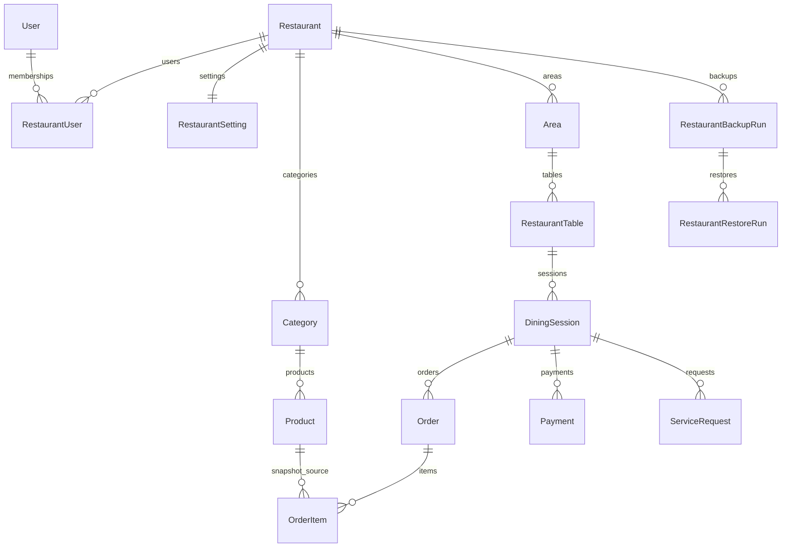

# Database

## Công nghệ và quy ước

- PostgreSQL 16, Prisma schema tại `prisma/schema.prisma`.
- ID dùng CUID; timestamp dùng `DateTime` UTC.
- Tiền dùng `Int` VND; thuế dùng `Decimal(5,2)`.
- Dữ liệu tenant có `restaurantId` và index tương ứng.
- Migration production dùng `pnpm prisma:deploy`; `prisma migrate dev` chỉ dùng development.

## Model

| Model | Mục đích và quan hệ quan trọng |
|---|---|
| `User` | Danh tính đăng nhập, password hash, platform role; liên kết membership, device, push, audit. |
| `Restaurant` | Tenant gốc; slug unique, trạng thái, plan, subscription, soft delete. |
| `RestaurantUser` | Membership User-Restaurant, role, username tenant và vòng đời xóa mềm. Username chỉ duy nhất giữa các membership chưa xóa. |
| `RestaurantSetting` | Tên/logo/liên hệ/timezone/ngôn ngữ, invoice và thuế. |
| `PushSubscription` | Web Push endpoint/key theo user, restaurant và thiết bị. |
| `StaffDeviceSession` | Thiết bị, người vận hành, ca làm, trạng thái thu hồi. |
| `Category`, `Product` | Danh mục và món theo tenant. |
| `ProductOptionGroup`, `ProductOptionItem` | Nhóm/lựa chọn tùy chọn món. |
| `Area`, `RestaurantTable` | Khu vực, bàn, QR token và trạng thái. |
| `DiningSession` | Phiên phục vụ của bàn, tổng tiền và thanh toán. |
| `Order`, `OrderItem` | Lượt gọi món và snapshot món/giá/option/trạng thái. |
| `Payment` | Giao dịch, snapshot invoice/bàn, phương thức và trạng thái. |
| `ServiceRequest` | Gọi nhân viên, nước, dụng cụ, thanh toán hoặc yêu cầu khác. |
| `Notification` | Thông báo tenant broadcast hoặc đích danh user. |
| `AuditLog` | Nhật ký hành động platform/tenant. |
| `PlatformDataPolicy` | Singleton lịch backup, retention và cleanup. |
| `PlatformSubscriptionPolicy` | Chính sách TRAIN/grace period. |
| `PlatformBackupRun` | Lịch sử backup toàn nền tảng. |
| `RestaurantBackupRun`, `RestaurantRestoreRun` | Backup/restore từng tenant. |
| `PlatformMaintenanceRun`, `PlatformWorkerHeartbeat` | Job nền và heartbeat. |
| `RestaurantStorageUsage` | Ước tính data/upload theo tenant. |
| `PlatformPlanPrice`, `PlatformPlanPriceHistory` | Giá BASIC/PRO và lịch sử. |
| `RestaurantSubscriptionRequest`, `RestaurantSubscriptionEvent` | Request và audit gói. |

## Quan hệ nghiệp vụ

## Toàn vẹn và đồng thời

- Order/Payment có idempotency unique theo tenant.
- Tạo phiên khóa hàng RestaurantTable; tạo order/thanh toán khóa phiên/hàng liên quan.
- Query update/delete tenant phải kèm `restaurantId` hoặc quan hệ tenant.
- Không cascade xóa dữ liệu tài chính trong nghiệp vụ thường; permanent delete bị chặn khi có lịch sử.

## Migration, seed và backup

- Không sửa migration đã chạy; tạo migration mới và review SQL.
- `prisma/seed.ts` chỉ dành cho môi trường mới/dev sau khi đã đọc nội dung.
- Backup phải đi cùng uploads, manifest và checksum; restore chỉ qua worker/môi trường cô lập.
