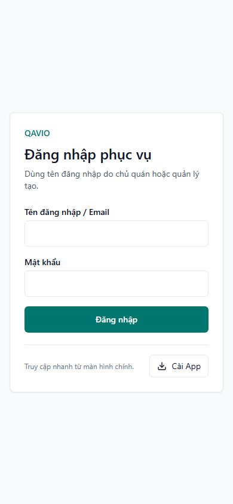

# PWA nhân viên — phát hành hai quy trình cài đặt

Ngày: 02/11/2026 (Asia/Bangkok).

**GO production:** app image mới đã chạy và qua smoke test. **Native iOS/Android acceptance: PENDING.** Chủ dự án duyệt phát hành sau báo cáo/giao diện QA bằng yêu cầu “oke chạy đi”. Việc triển khai production không được coi là bằng chứng cài đặt hoặc chuyển cookie native thành công.

## Phiên bản và CI

- Source: `55ef71cd7e3979d7ad950bbf376768e876e48b18` (`55ef71c`). Commit/push main chỉ 27 file source/test/workflow thuộc PWA và 17 file báo cáo/bằng chứng. Không gộp bộ lọc báo cáo, dữ liệu demo/upload hoặc source QAVIO.
- [CI Linux 41425488329](https://github.com/herry-huynhlong/restaurant/actions/runs/41425488329): **SUCCESS**. Lint/typecheck, offline deploy tests, pricing/subscription, tài chính Phase 0 và HTTP/PostgreSQL PWA trên image đóng gói đều đạt; bao gồm UI test mới và 25 nhóm PWA cho bốn bộ phận.
- [Review artifact 41426232470](https://github.com/herry-huynhlong/restaurant/actions/runs/41426232470): **SUCCESS**; kiểm source SHA, run, manifest và checksum trước production.
- Image: `quanpilot-app:55ef71c`.
- Image ID thực chạy: `sha256:2421ed83bb0ae411f973da84edbd2b91b09ec0266e5530288ac8751f4f79e839`.
- Manifest SHA-256: `f06891fb41121399ac4fe921bd219071efc0b014ee41c431a89535c3243c6268`.
- GitHub artifact digest: `sha256:df5300811e2b2b76025589d34a758dd4ecfbc6688da15983aa557456690017a7`.
- Archive 315.334.564 byte; budget layer giải nén 1.187.329.024 byte. CI tái sử dụng runtime base đã xác minh của `d06e3a7` sau kiểm tra dependency/Dockerfile/public không đổi; build/kiểm thử toàn bộ vẫn chạy trên GitHub-hosted runner.

## Bản sửa phát hành

- Cookie thiết bị hợp lệ có ưu tiên cao hơn localStorage rỗng/cũ; không truyền JWT/password/session qua URL hoặc JS storage.
- Server kiểm session, membership, tenant, entitlement và trạng thái thiết bị trước khi chuyển workspace. API trạng thái chỉ đọc, private/no-store; thiết bị bị thu hồi không tự được kích hoạt lại.
- Hỗ trợ cài trước hoặc sau đăng nhập. Nút cài gọn dưới form trong browser; không render nút/hướng dẫn khi standalone hoặc khi chưa nhận diện xong môi trường. Trang không chứa tên fixture QA cố định.
- Giữ nguyên NextAuth/secret/cookie session, xác thực thiết bị, phân quyền và tenant isolation. Không migration hoặc thay subscription/payment.

Chi tiết source/QA: [implementation](PWA_DUAL_FLOW_IMPLEMENTATION.md), [UI review](PWA_LOGIN_UI_REVIEW.md).

## Backup, dung lượng và phương án quay lại

- Backup PostgreSQL/uploads mới lúc `2026-11-02T10:02:34Z`, mã hóa và tải ra ngoài VPS. Checksum và restore trên database tạm localhost:55432 PASS, 28 migration hiện hữu; archive media được kiểm tra. Database tạm và file giải mã được dọn; bản mã hóa giữ ngoài repository. Không restore production.
- Đầu phiên disk free 11.353.346.048 byte (~10,57 GiB); MemAvailable 438.024 KiB. Trước cutover, gate có 11.034.030.080 byte trống; incoming budget 1.187.329.024 + reserve 2.610.569.625 = cần 3.797.898.649 byte; **PASS**. RAM available ở gate apply 535.629.824 byte.
- Sau load/cutover và xóa đúng archive staging mới đã xác minh: disk free 11.334.418.432 byte (~10,56 GiB), RAM available ghi ngay sau cutover 520.499.200 byte. Không prune, xóa backup/volume/log hoặc image của ứng dụng khác.
- Giữ rollback image `quanpilot-app:d06e3a7`, ID `sha256:3f3149fe5412523950b03a7cc17ae87d3768f6041b5b5328e2c36b54e01cd7eb`.
- Private release directory: `/opt/websites/restaurant/.trial-runtime/pwa-sso-release-20261102/`; giữ `overlay-before.private.yaml` và `cutover/rollback-pinned.json`. Không đưa resolved Compose/env vào Git.

Nếu cần rollback app, dùng overlay cũ đã lưu và pinned Compose trong private release directory, project `restaurant`, chỉ service `app`:

```sh
docker compose --project-directory /opt/websites/restaurant -p restaurant \
  -f /opt/websites/restaurant/.trial-runtime/pwa-sso-release-20261102/cutover/rollback-pinned.json \
  up -d --no-build --pull never --no-deps app
```

Khôi phục tag trong runtime overlay từ bản lưu riêng khi rollback; kiểm lại HTTP/image và các container khác. Không restore database chỉ để đảo code, không down/down-v hoặc restart PostgreSQL/worker/Engine.

## Kết quả production

Deploy qua guard image-only, xác minh image config/rootfs/source; chỉ recreate `restaurant-app-1`. Giữ nguyên runtime environment và mounts. App mới qua HTTP nội bộ/public `/restaurant-login`, `/api/public/pricing`; QAVIO `/` và `/api/ready` đạt.

7/7 container running; sáu container ngoài app giữ ID/image/startedAt/restart count. QAVIO web/worker và hai PostgreSQL healthy. QuánPilot app/maintenance-worker và Portfolio không có Docker healthcheck, nên chỉ ghi running, không gắn nhãn healthy Docker cho chúng.

| Bộ phận | Manifest production | Start URL |
| --- | --- | --- |
| Quản lý | `/thien-dao/admin/manifest.webmanifest` | `/thien-dao/login?pwa=1&role=MANAGER` |
| Phục vụ | `/thien-dao/staff/manifest.webmanifest` | `/thien-dao/login?pwa=1&role=WAITER` |
| Bếp | `/thien-dao/kitchen/manifest.webmanifest` | `/thien-dao/login?pwa=1&role=KITCHEN` |
| Thu ngân | `/thien-dao/cashier/manifest.webmanifest` | `/thien-dao/login?pwa=1&role=CASHIER` |

Scope đều `/thien-dao/`, id theo bộ phận. Start URL và workspace cũ khi thiếu phiên về đúng login, không báo QR khách không hợp lệ. API `/api/restaurants/thien-dao/pwa/status` trả 401/NO_SESSION khi không đăng nhập. Employee manifest generic đúng; customer manifest vẫn mở `/thien-dao/welcome`.

Browser production viewport390 xác nhận bốn tiêu đề/manifest, nút cài dưới form, không chữ QA, không tràn ngang và không console/hydration error quan sát được. Không đăng nhập/tạo tài khoản QA hoặc giao dịch production. Luồng có phiên và A/B được kiểm trên image CI/PostgreSQL cô lập; không gọi kiểm tra anonymous production là kiểm thử đăng nhập thật đủ bốn quyền.

Trong cửa sổ smoke ban đầu: TypeError, ReferenceError, PrismaClientKnownRequestError, P2028 và deadlock detected đều 0. Kết quả theo dõi sau cửa sổ tối thiểu180 giây được ghi riêng tại `pwa-sso-production/stability.json`; không thay thế giám sát dài hạn.

Kiểm tra ổn định cuối sau **232 giây**: PASS, app restart count0, đúng image/source mới, 7 container running và sáu container khác giữ nguyên. Log app/PostgreSQL từ lúc app khởi động không ghi nhận các lỗi được đếm (gồm P2028/deadlock/transaction timeout); safe Nginx access log dùng chung có63 request, **0 HTTP5xx** trong cửa sổ này. Disk free11.334.397.952 byte, MemAvailable484.843.520 byte. App giữ log rotation json-file10m×3; không đổi logging/recreate worker hoặc PostgreSQL.

## Giới hạn nghiệm thu và sử dụng

- A tự vào workspace khi OS chuyển đủ session/device cookie hợp lệ. Không bảo đảm chuyển cookie trên mọi iOS/browser. Khi không được chuyển, giữ đúng nhà hàng và xử lý thiếu phiên an toàn; đây không phải PASS một lần đăng nhập cho A.
- B cài trước rồi nhập tài khoản một lần trong app, mở lại với phiên hợp lệ vào workspace. Những kết quả tự động không chứng minh OS đã cài/mở app thật.
- Standalone ẩn nút/hướng dẫn đã kiểm bằng React và mô phỏng browser. Chưa có native device/device farm kết nối; **native acceptance vẫn PENDING**, không yêu cầu cấu hình từng máy nhân viên.
- Không ép đổi secret, đăng xuất toàn hệ thống hoặc xóa icon đang đúng để phát hành. Icon đời cũ trỏ QR khách vẫn cần thay bằng icon cài từ liên kết bộ phận đúng như hướng dẫn trước. Không công bố đạt chuyển phiên Safari→PWA trên thiết bị thật cho bản này.
- Chưa có load test100–1.000 thiết bị; không suy từ các test chức năng thành bảo đảm capacity VPS1GB.

Bằng chứng sanitized: [production evidence](pwa-sso-production/). Không chứa env/cookie/dump/credential hoặc dữ liệu khách hàng.


