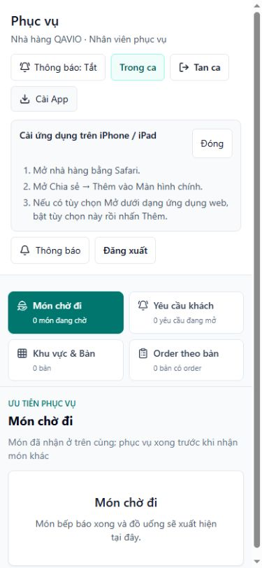

# Nút Cài App/hướng dẫn bị che trên iPhone — sửa giao diện

Ngày: 02/11/2026. Baseline production: `55ef71c`. **Đã sửa và kiểm thử local QA; chưa commit/push/deploy.**

## Nguyên nhân có bằng chứng

Ảnh iPhone do chủ dự án cung cấp cho thấy một phần hướng dẫn “iPhone / iPad” phía trái và thanh tab Phục vụ che ngang. Đã tái hiện cùng bố cục trên production-build local với nhà hàng/tài khoản tổng hợp, không dùng dữ liệu production.

Phần tử là khung `help` trong `src/components/app-shell/install-app-button.tsx`, trước đây có:

```text
absolute right-0 z-20 mt-2 w-72 max-w-[calc(100vw-3rem)]
```

Nó căn mép phải theo wrapper chỉ rộng bằng nút Cài App. Khi nút nằm mép trái, khung288px bị đẩy khỏi viewport: DOM đo **x=-173,484375px**, y175px, width288px. `max-width` không sửa được tọa độ âm này.

Thanh tab tại `src/components/staff/staff-workspace-tabs.tsx` là `sticky top-0 z-20`, có backdrop blur. Nó nằm sau header trong DOM, cùng z-index20 với hướng dẫn; tại vùng giao nhau150px, `elementFromPoint` trỏ vào nội dung tab thay vì hướng dẫn. Vì vậy khung vừa bị cắt bên trái vừa bị tab che lên. Đây không phải suy đoán màu nền/CSS Safari riêng.

[Số đo trước](pwa-install-overlay/before-dom.json), [ảnh tái hiện trước](pwa-install-overlay/before-waiter.png).

Không tìm thấy logic tự mở hướng dẫn khi tải trang: trạng thái khởi tạo là null, chỉ được đặt khi người dùng bấm nút và trình duyệt trả kết quả cài đặt/hướng dẫn. Không suy từ ảnh rằng popup đã tự bật mà không có thao tác.

## Cách sửa

- Bỏ absolute positioning, right anchor và z-index của hướng dẫn. Dùng section trong luồng bố cục thường, width theo container và max-width384px; khi mở, wrapper chiếm cả hàng của vùng chức năng.
- Hướng dẫn đẩy các phần sau xuống; không có portal, backdrop, fixed layer, khóa cuộn hoặc focus trap. Không tăng z-index để phủ lên tab.
- Giữ nút Cài App ở trước hướng dẫn, có trạng thái aria-expanded/aria-controls. Đóng được bằng nút Đóng ở đầu khung, Escape hoặc bấm lại Cài App; đóng trả focus về nút cài, không ép cuộn.
- Nút Đóng có chiều cao tối thiểu44px. Chữ dài được wrap, trang đăng nhập cũng cho footer xuống hàng khi mở hướng dẫn.
- Giữ nguyên điều kiện `!ready || standalone` trả null, nên standalone không có cả nút/hướng dẫn ngay cả khi help state đã được đặt.

Sau sửa ở QA390px: khung static x16px, width343px, bottom344px; tab bắt đầu y425px, không còn giao nhau. Hit test tại tâm nút Cài App trả đúng nút. [Số đo sau](pwa-install-overlay/after-dom.json).

## File thay đổi

1. `src/components/app-shell/install-app-button.tsx`: chỉ bố cục/hành vi đóng hướng dẫn và accessibility.
2. `scripts/staff-pwa-install-ui-checks.ts`: thêm render test cho trạng thái mở, không floating overlay và standalone ẩn cả help đã mở.
3. Báo cáo này cùng thư mục `docs/pwa-install-overlay/`.

Không đổi cookie, QR, session, xác thực thiết bị, membership, phân quyền, source thanh tab, database, worker hay chức năng khác. Các thay đổi period/report đang có trong working tree không nằm trong nhiệm vụ/candidate này.

## Kiểm thử đã chạy

| Nhóm | Kết quả |
| --- | --- |
| Next production build, lint, TypeScript | PASS trên candidate cô lập, không gộp report filter |
| `staff-pwa-install-ui-checks.ts` | PASS: SSR/standalone ẩn CTA; help mở là region trong flow, có close/expanded state, không absolute/fixed/z20 |
| `staff-pwa-session-checks.ts` | PASS hồi quy cookie/controller/startup/recovery |
| `install-help-checks.ts` | PASS iPhone/iPad/Android/desktop instructions |
| `staff-pwa-http-checks.ts` | PASS25 nhóm với PostgreSQL QA riêng: đủ4bộ phận, A/B, session, tenant và revoked |
| Browser QA4bộ phận | PASS: không tự mở; nút hit-test đúng; khung nằm trong viewport, không đè tab; Đóng hoạt động |
| Standalone mô phỏng4bộ phận | PASS: nút/hướng dẫn đều ẩn |
| Escape/toggle | PASS, Escape trả focus về nút cài |
| Browser viewport320/375/390/768, cao568 | PASS: không tràn ngang, khung static, nút hit-test đúng |
| Login320px khi mở hướng dẫn | PASS, khung nằm trong container, không tràn ngang |
| Console/hydration | Không ghi nhận lỗi trong phiên QA |
| Native Safari sau sửa, safe-area/thanh địa chỉ động thực tế | **PENDING**, không có thiết bị/device farm kết nối |

Khung không gắn đáy viewport, không có max-height/fixed overlay hoặc khóa body; dùng cuộn trang bình thường. Viewport thấp568px kiểm tra không gian hạn chế nhưng không giả lập thanh Safari hoặc giá trị safe-area native. Cần phân biệt kiểm tra bố cục này với nghiệm thu trên iPhone thật.

QA proxy ngoài source/release chỉ cung cấp userAgent iPhone và navigator.standalone để chọn nhánh hướng dẫn/hiển thị. **Engine trình duyệt không đổi thành Safari/WebKit**, không cài PWA native và không kiểm chứng chuyển cookie OS. Theo chủ dự án, standalone của bản55ef71c trên iPhone đã ẩn nút đúng; bản sửa giữ nguyên điều kiện đó.

Fixture đã đăng xuất và dọn khỏi database QA; không tạo lead/order/payment hay sửa dữ liệu production. File credential QA được dọn. Server/proxy QA do tác vụ tạo được dừng sau kiểm tra.

## Ảnh đối chiếu

Tất cả ảnh dưới là browser QA với dữ liệu tổng hợp, không phải screenshot Safari native sau sửa.

| Trước — lỗi đã tái hiện | Sau — hướng dẫn trong bố cục |
| --- | --- |
|  |  |

Ảnh sau của [Quản lý](pwa-install-overlay/after-manager.png), [Bếp](pwa-install-overlay/after-kitchen.png), [Thu ngân](pwa-install-overlay/after-cashier.png).

Ảnh standalone mô phỏng: [Phục vụ](pwa-install-overlay/standalone-waiter.png), [Quản lý](pwa-install-overlay/standalone-manager.png), [Bếp](pwa-install-overlay/standalone-kitchen.png), [Thu ngân](pwa-install-overlay/standalone-cashier.png). [Kết quả máy đọc](pwa-install-overlay/results.json).

**Chưa phát hành.** Production vẫn55ef71c. Bản sửa sẵn sàng review giao diện; không tuyên bố đã nghiệm thu Safari native sau sửa. Chờ chủ dự án duyệt trước bước commit/push/CI/deploy.
