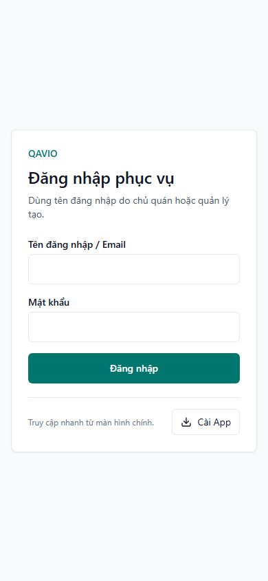

# Phát hành sửa hướng dẫn Cài App bị che

Ngày: 02/11/2026, Asia/Bangkok. **GO production: image mới đã chạy, smoke test đạt. Nghiệm thu Safari/iPhone native sau sửa vẫn PENDING.**

Chủ dự án duyệt CI/CD sau khi xem báo cáo và ảnh trước/sau. Lần phát hành chỉ thay bố cục/hành vi đóng hướng dẫn; không thay authentication, cookie, QR, phân quyền hoặc dữ liệu.

## Source, CI và artifact

- Source: `d41191f11ce5b9fbefcda002f39b49062a394089` (`d41191f`), đã commit/push main. Chỉ hai file source/test cùng13file báo cáo/bằng chứng của nhiệm vụ; không gộp period/report filter, upload/demo hoặc QAVIO.
- Source sửa: `src/components/app-shell/install-app-button.tsx`; test: `scripts/staff-pwa-install-ui-checks.ts`.
- [CI Linux41462279883](https://github.com/herry-huynhlong/restaurant/actions/runs/41462279883): SUCCESS. Lint/typecheck, deployment safeguards, pricing/subscription, tài chính Phase0, UI/session/install/icon và25nhóm PWA HTTP/PostgreSQL trên image đóng gói đều đạt.
- [Artifact review41463167588](https://github.com/herry-huynhlong/restaurant/actions/runs/41463167588): SUCCESS. Đúng run/source SHA và checksum; VPS kiểm lại bản tải độc lập.
- Image tag: `quanpilot-app:d41191f`.
- Image ID đang chạy: `sha256:0899628b7077c64aa4aace41182dac61846254f73fd83bbface1fb50dbcba72e`.
- Manifest SHA256: `d47d8374bdd8362848beb5e72c4314a8e76bc1d8772e82ef435c194e4af68b3f`.
- GitHub artifact digest: `sha256:713332f3c779c880c0a826ff0aa65398028f1345c62e2ff8450f74b3f3d6908f`.
- Archive317.276.102byte, layer budget1.197.580.288byte. Build nặng chạy hoàn toàn trên GitHub-hosted runner; runtime base55ef71c được tái sử dụng sau kiểm tra dependency/Dockerfile/public không đổi. VPS không build/pull.

## Bản sửa đã phát hành

Khung hướng dẫn không còn `absolute right-0 z-20` căn theo nút nhỏ. Section mới nằm trong normal flow, chiếm cả hàng khi mở, không phủ workspace hoặc cạnh tranh z-index với tab sticky. Có nút Đóng ở đầu, Escape và bấm lại Cài App; không khóa cuộn, không backdrop/portal. Điều kiện ẩn toàn bộ nút/hướng dẫn khi standalone giữ nguyên.

Phân tích DOM và ảnh trước/sau: [PWA_INSTALL_OVERLAY_FIX.md](PWA_INSTALL_OVERLAY_FIX.md). Các ảnh workspace4bộ phận/standalone trong báo cáo đó là QA; không phải native Safari sau sửa.

## Backup, capacity và cutover

- Backup DB/uploads mới lúc21:29:29 (UTC+7), mã hóa, tải off-host và kiểm checksum. Restore trên database tạm localhost:55432 PASS với28migration hiện hữu; archive media hợp lệ. Database tạm/file giải mã đã dọn, bản mã hóa giữ ngoài Git. Không restore production.
- Trước tải: disk free11.331.514.368byte, MemAvailable464.308KiB,7container running, app cũ55ef71c.
- Preflight trước apply: free11.010.224.128byte; cần3.808.149.913byte gồm image budget và reserve2.610.569.625byte; RAM available481.505.280byte. Gate PASS, runtime Compose/env được kiểm đối chiếu.
- Guard load/xác minh image/source/config/rootfs, pin image ID; chỉ recreate service `app` với `--no-build --pull never --no-deps`. Environment/mounts giữ nguyên; không migration, restart PostgreSQL/worker/Engine hoặc đổi Nginx/DNS.
- Sau cutover và xóa đúng archive staging mới đã xác minh: free11.312.611.328byte (~10,54GiB). Không prune image, volume, backup hoặc log; không xóa dữ liệu.
- Giữ image rollback55ef71c, ID `sha256:2421ed83bb0ae411f973da84edbd2b91b09ec0266e5530288ac8751f4f79e839`.

## Kiểm tra production

- HTTP QuánPilot `/restaurant-login`, `/api/public/pricing` và QAVIO `/`, `/api/ready` PASS.
- Bốn manifest/start URL đúng MANAGER/WAITER/KITCHEN/CASHIER của slug `thien-dao`; thiếu phiên về đúng login, không lỗi QR khách. API trạng thái trả401/NO_SESSION khi anonymous. Customer manifest vẫn mở welcome.
- Browser production viewport390 kiểm cả4trang login: không tự mở hướng dẫn; sau bấm Cài App, panel có `position: static`, x41→349px trong viewport390px, nút hit-test đúng, Đóng hoạt động. Không console/hydration error quan sát được.
- Trình duyệt kiểm thử thực tế là desktop ở viewport mobile, nên hướng dẫn hiện “máy tính”; không đổi UA production để gọi đó là Safari. [Ảnh hướng dẫn thật trên production](pwa-install-overlay-production/login-help-browser.png).
- Không tạo tài khoản/giao dịch QA hoặc đăng nhập tài khoản nhân viên thật trên production. Workspace4quyền, sticky overlap, iOS instructions và standalone được kiểm QA/image CI; không báo những kiểm tra đó là native production acceptance.
- 7/7container running,6container ngoài app giữ ID/image/startedAt/restart count. QAVIO web/worker và hai PostgreSQL healthy. App/maintenance-worker/Portfolio không có Docker healthcheck; ghi running và dùng HTTP để kiểm app, không gắn nhãn healthy Docker giả.
- Smoke ban đầu không ghi nhận TypeError, ReferenceError, PrismaClientKnownRequestError, P2028 hoặc deadlock detected trong cửa sổ log kiểm tra. Theo dõi ổn định tối thiểu180giây ghi riêng tại `pwa-install-overlay-production/stability.json`.

### Kết quả theo dõi và một lỗi trong cutover

Sau246giây: app restart count0,7container chạy,6container ngoài app giữ nguyên. Safe access log dùng chung ghi104request và **1HTTP502**, không phải zero5xx. Đã dừng chốt báo cáo để đối chiếu lỗi này.

Nginx error log xác nhận `recv() failed` / `connection reset by peer` tại upstream QuánPilot127.0.0.1:3000, lúc21:40:19 (UTC+7), khoảng1,29giây sau khi container mới bắt đầu. Mốc file xác nhận readiness thành công là21:40:32,65; lỗi xảy ra trước mốc này. Đây là gián đoạn ghi nhận trong cửa sổ thay container, không được gọi là phát hành zero-downtime. Không có bằng chứng lỗi ứng dụng tiếp diễn sau readiness, nên không kích hoạt rollback.

Kiểm tra tiếp sau **402giây**: đúng source/image mới, restart count0;7container running,6container khác giữ nguyên. Tổng141request trong log dùng chung có1HTTP502; **135request sau readiness,0HTTP5xx**. Các bộ đếm lỗi app/PostgreSQL được theo dõi vẫn0 (gồm P2028, deadlock và transaction timeout). Disk free11.312.562.176byte (~10,54GiB), MemAvailable496.844.800byte; app giữ json-file10m×3. Các HTTP probe cuối tiếp tục PASS.

Bằng chứng: [stability ban đầu](pwa-install-overlay-production/stability.json), [đối chiếu startup](pwa-install-overlay-production/startup-5xx-triage.json), [follow-up](pwa-install-overlay-production/stability-followup.json). Không xuất raw access/error log hoặc dữ liệu khách hàng. Kết quả này không thay thế giám sát dài hạn hoặc nghiệm thu native.

## Rollback và nghiệm thu còn lại

Private release directory: `/opt/websites/restaurant/.trial-runtime/pwa-overlay-release-20261102/`. Giữ `overlay-before.private.yaml`, `cutover/rollback-pinned.json` và backup/off-host proof. Không đưa env/resolved Compose vào Git.

Khi rollback ứng dụng đã được duyệt, khôi phục runtime overlay từ bản lưu và chỉ chạy:

```sh
docker compose --project-directory /opt/websites/restaurant -p restaurant \
  -f /opt/websites/restaurant/.trial-runtime/pwa-overlay-release-20261102/cutover/rollback-pinned.json \
  up -d --no-build --pull never --no-deps app
```

Kiểm lại image/HTTP và6container khác. Không restore DB chỉ để đảo thay đổi code, không down/down-v hoặc restart worker/PostgreSQL.

Safari/iPhone thật sau bản sửa: **PENDING**, chưa có thiết bị/device farm kết nối. Chủ dự án đã kiểm chứng bản55ef71c standalone ẩn nút đúng; bản mới giữ nguyên điều kiện này. QA UA/standalone simulation không đổi engine thành WebKit và không thay thế kiểm tra safe-area/thanh Safari thực tế.

Để nhận giao diện mới, có thể tải lại trang Safari đang dùng rồi bấm Cài App; không yêu cầu xóa cookie, đăng xuất hoặc cài lại icon đúng bộ phận cho thay đổi UI này. Không tuyên bố lỗi đã được nghiệm thu hoàn toàn trên iPhone chỉ từ CI/HTTP/browser desktop.

Bằng chứng sanitized: [pwa-install-overlay-production](pwa-install-overlay-production/). Không chứa credential, signed URL, env, dump hay dữ liệu khách hàng.


