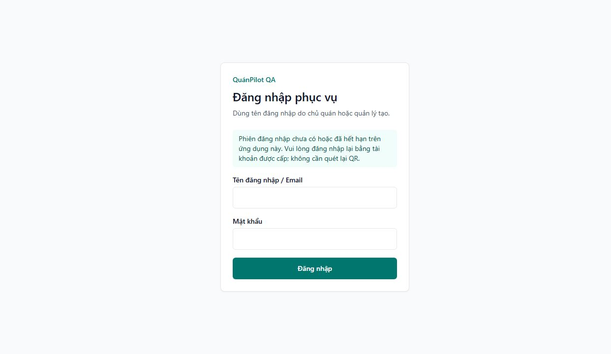
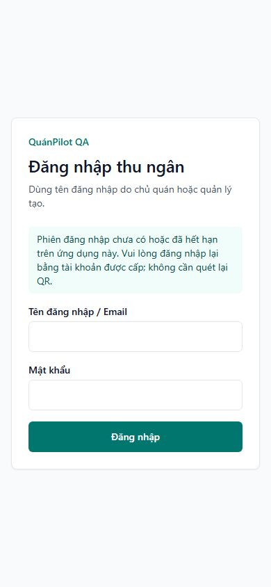

# QR nhân viên và PWA — 02/11/2026

## Kết quả và phạm vi

Đã sửa, commit/push riêng và phát hành source `d06e3a7ac69dfcc66ceaa9a1bfd57f4e3497616b` sau phê duyệt tiếp theo của chủ dự án. Không ghi dữ liệu production hoặc đổi QAVIO marketing. Chủ dự án xác nhận gặp lỗi trên hai iPhone mới: web đăng nhập được, icon ứng dụng mở lỗi. Sau phát hành, chủ dự án trả lời **“Chưa kiểm tra trên iPhone”**; nghiệm thu native vẫn PENDING. Không coi HTTP/browser desktop là kiểm thử thiết bị thật. Xem [báo cáo production](STAFF_QR_PWA_PRODUCTION.md).

## Nguyên nhân đã xác minh

- QR ở Nhân viên là URL `/{slug}/login?role=MANAGER|WAITER|KITCHEN|CASHIER`, không phải bearer token đăng nhập. Tài khoản/mật khẩu và membership phía server mới cấp quyền.
- Layout `src/app/[rSlug]/layout.tsx` mặc định dùng manifest customer. Trang login và device-setup trước đây không override nên kế thừa manifest gọi món.
- Kiểm tra HTTP chỉ đọc production: `/thien-dao/login?role=WAITER` trả 200, HTML gắn `/thien-dao/manifest.webmanifest`. JSON đó có id `/thien-dao/pwa/customer`, scope `/thien-dao/`, start_url `/thien-dao/welcome`. `/thien-dao/welcome` không có `t` trả HTML với `QR không hợp lệ.`. Đây là đường đi tái hiện được bằng cấu hình đang phát hành, không suy đoán token nhân viên hết hạn.
- Thông báo thực tế trong source tại `welcome/page.tsx`: không có `t` → `QR không hợp lệ.`; token bàn không tồn tại trong đúng nhà hàng → mã QR không còn hiệu lực; bàn inactive → thông báo riêng. Không sửa hoặc bỏ qua kiểm tra mã bàn.
- Workspace staff/kitchen/cashier/admin đã có manifest riêng, nhưng giai đoạn login/setup trước workspace dùng sai manifest. Không có service worker cache điều hướng: `public/sw.js` fetch handler rỗng, không lưu URL đăng nhập/token. Cookie NextAuth giữ phiên JWT; cookie staffDeviceId và StaffDeviceSession kiểm soát thiết bị nhân viên. Không tìm thấy cơ chế khôi phục bằng QR token trong localStorage/sessionStorage.
- Nhánh không có phiên trong guard trước đây về `/login` chung, làm mất ngữ cảnh cửa hàng. Callback mặc định của tenant login về `/post-login` chung có thể đưa tài khoản nhiều membership đến chọn nhà hàng.

## Bản sửa

1. Login từ QR chọn metadata/manifest theo role đã whitelist; role lạ dùng manifest employee an toàn. Device setup chọn manifest từ membership của session, không tin role do client truyền.
2. Giữ nguyên id manifest admin/staff/kitchen/cashier và scope nhà hàng. Start URL nhân viên là `/{slug}/login?pwa=1&role=...`, không chứa mật khẩu, JWT, mã bàn hoặc thông tin cá nhân. Thêm manifest employee cho login không chỉ rõ role; customer manifest giữ nguyên.
3. Khi còn session hợp lệ, login server giải membership trong đúng slug rồi vào workspace/kiểm tra thiết bị hiện có. Không enroll lại thiết bị nếu cookie/device session hợp lệ.
4. Khi thiếu session, app hiện hướng dẫn: “Phiên đăng nhập chưa có hoặc đã hết hạn trên ứng dụng này. Vui lòng đăng nhập lại bằng tài khoản được cấp; không cần quét lại QR.” Guard tenant giữ slug và gợi ý bộ phận khi chuyển về login. Trang login QR lần đầu không gắn pwa=1 không khẳng định phiên hết hạn.
5. Callback mặc định sau nhập tài khoản trong tenant login quay về login của chính slug đó để server giải quyền. Không hardcode nhà hàng; query role chỉ chọn nhãn/manifest, không gán quyền.
6. Không đổi NextAuth strategy/secret/expiry/cookie, device storage, service worker, QR khách, subscription, payment hoặc schema. Không thêm token vào localStorage và không tạo cơ chế bỏ qua mật khẩu.

## File thay đổi trong task này

- `src/lib/tenant-pwa.ts`: mapping context/đường mở app, hàm thuần.
- `src/server/services/tenant-pwa-service.ts`: dùng start URL nhân viên và context employee.
- `src/app/[rSlug]/login/page.tsx`: metadata theo role whitelist và thông báo thiếu phiên.
- `src/app/[rSlug]/device-setup/layout.tsx`: metadata theo membership server.
- `src/app/[rSlug]/employee/manifest.webmanifest/route.ts`: manifest không chỉ rõ bộ phận.
- `src/components/app-shell/restaurant-login-form.tsx`: callback giữ tenant.
- `src/lib/rbac/guards.ts`: login redirect giữ ngữ cảnh tenant; toàn bộ kiểm tra membership/plan/role giữ nguyên.
- `scripts/staff-pwa-checks.ts`, `scripts/staff-pwa-http-checks.ts`: kiểm thử manifest, authentication thật và tenant isolation.
- Báo cáo và bằng chứng `docs/staff-pwa-audit/`.

Các thay đổi report-period, icon/install button/PWA audit và ảnh demo đã tồn tại trước task không được sửa/gộp vào bản này. Production build hiện kiểm tra working tree kết hợp; khi phát hành cần chọn riêng file của task, kiểm CI trên commit phát hành chính xác.

## Kiểm thử

Môi trường: PostgreSQL localhost:55432, database riêng `staff_pwa_test` tạo mới từ 28 migration hiện có; Next.js localhost:3450, trial registration false. Chỉ dùng tài khoản ngẫu nhiên @example.invalid, hai nhà hàng QA và tên demo. Test tự dọn user/membership/device/audit/restaurant thuộc lượt chạy sau khi xong, không ghi Payment hoặc dữ liệu kinh doanh. Không truy vấn DB production; production chỉ GET public HTML/manifest.

| Kiểm tra | Kết quả |
| --- | --- |
| Lint | PASS, không warning/error |
| TypeScript `tsc --noEmit` | PASS |
| Production `next build` | PASS, có route employee manifest |
| `staff-pwa-checks.ts` | PASS: bốn context, scope/id ổn định, start URL không credential, role lạ, customer unchanged |
| HTTP/PG E2E development | PASS, 17 nhóm |
| HTTP/PG E2E production build | PASS, 17 nhóm |
| Browser production build | PASS: login bốn role, đúng manifest và hướng dẫn; desktop1280/mobile390 không tràn ngang, không console error quan sát được |
| Hồi quy rộng 18 script | 17/18 PASS; lỗi đã có ở `popup-form-ux-checks.ts` vì `src/components/admin/report-period-filter.tsx` untracked từ task trước chưa có pending submit theo quy tắc scanner. File đó không thuộc/sửa bởi bản QR. Không báo toàn bộ regression xanh |
| Add to Home Screen / đóng mở native iOS, Android | Chưa kiểm chứng trên thiết bị thật |

Mỗi bộ phận được kiểm: HTML login/manifest → mật khẩu sai bị từ chối → đăng nhập thật NextAuth → thiết lập thiết bị qua API với WAITER/KITCHEN/CASHIER → tạo client mới giữ cookie như mở lại → đúng workspace và chỉ một device session → sửa query role không tăng quyền → không truy cập tenant khác → membership inactive bị chặn → không có cookie dẫn về login của tenant, không welcome. Test theo cả redirect HTTP và redirect streaming trong HTML. Kiểm tra customer manifest riêng vẫn mở welcome để QR bàn tiếp tục được xác thực.

Kết quả browser: [browser.json](staff-pwa-audit/browser.json). Ảnh là QA; không phải screenshot ứng dụng native iPhone.

## Phát hành và nghiệm thu còn lại

- Source đã qua CI Linux trên checkout sạch và phát hành image-only riêng QuánPilot app; giữ rollback, kiểm capacity/backup theo runbook; không recreate PG/worker hoặc migration. Không tuyên bố lỗi iPhone đã hết.
- Đã kiểm HTML QR login từng role, JSON manifest/start_url, HTTP readiness và giao diện production; không tạo tài khoản QA hoặc giao dịch giả production. Hồi quy form UX PASS trên checkout sạch của CI; lỗi scanner local do report filter sửa dở không nằm trong commit phát hành.
- Trên từng iPhone của chủ dự án: Safari → QR bộ phận → đăng nhập → hoàn tất tên thiết bị nếu có → thêm màn hình chính → đóng Safari → mở icon → vào đúng workspace → đóng/mở lại lần nữa. Thử riêng bốn role, sau đó thử hết phiên để thấy login rõ ràng. Android cần quy trình tương tự.
- Icon đã cài bằng id customer/start_url welcome trước bản sửa có thể phải gỡ và thêm lại từ đúng trang nhân viên một lần. Không cam kết cập nhật hồi tố được mọi icon iOS cũ.
- Nếu app mới không có cookie phiên của trình duyệt, không khôi phục bằng cách đọc/copy JWT từ storage hoặc bypass auth: đăng nhập tài khoản một lần trong app, sau đó kiểm đóng/mở giữ phiên. Chưa xác nhận hành vi chuyển cookie trên hai iPhone cụ thể; đây là phần nghiệm thu native còn thiếu.
- Nếu sau cài mới manifest đúng vẫn lỗi, lấy đường dẫn khởi chạy và phiên bản iOS/trình duyệt để phân biệt cookie không có với lỗi QR; không yêu cầu gửi cookie/token/password.
