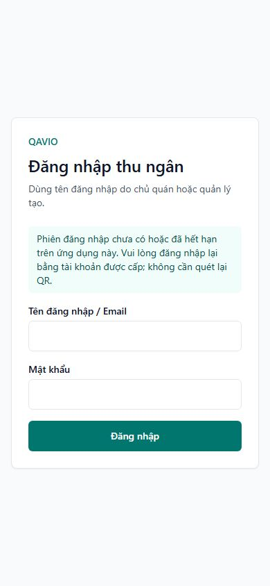

# QR nhân viên/PWA — phát hành production 02/11/2026

## Trạng thái

**GO: đã phát hành production và kiểm tra sau deploy đạt.** Source `d06e3a7ac69dfcc66ceaa9a1bfd57f4e3497616b` thực sự chạy trong QuánPilot app. **Nghiệm thu iPhone vẫn PENDING**: sau khi nhận hướng dẫn, chủ dự án trả lời “Chưa kiểm tra trên iPhone”. Không tuyên bố lỗi đã sửa hoàn toàn trên thiết bị thật.

## Phiên bản và phạm vi

- Source `d06e3a7ac69dfcc66ceaa9a1bfd57f4e3497616b`, image tag `quanpilot-app:d06e3a7`.
- Chỉ chọn 14 file QR/PWA, test, CI và bằng chứng từ working tree. Không gộp period/report filter, icon/install button, ảnh demo hoặc source QAVIO.
- Không thay schema/migration, subscription/payment, database production, OAuth, secrets/quyền, DNS/Nginx, PostgreSQL hoặc worker.
- CI Linux [41402480413](https://github.com/herry-huynhlong/restaurant/actions/runs/41402480413) SUCCESS: lint/TypeScript, an toàn deploy, pricing/checkout, financial Phase 0 và kiểm thử PWA/nhân viên trên Docker image đóng gói với PostgreSQL cô lập. Test form UX cũng PASS trên checkout sạch, không có report filter chưa phát hành.
- Release review [41402999714](https://github.com/herry-huynhlong/restaurant/actions/runs/41402999714) SUCCESS. Manifest SHA256 `b9a9cccfe7f2c552eb226a9a6e7268bf3b3ee9eee31a0988d2f19844c525b486`; GitHub artifact digest `sha256:3a82414bc931278192c75d2a0100d8a421beeb8b31cd1e85fcfc2d6c54a2e24e`. Archive 313.390.590 byte, budget layer giải nén 1.177.081.344 byte.

## Backup, capacity và rollback

- Backup DB và uploads mới trước phát hành: mã hóa, tải ra ngoài VPS, checksum PASS, restore trên database tạm localhost:55432 PASS với 28 migration. Archive uploads đã kiểm checksum/đọc danh sách an toàn. DB tạm và dữ liệu giải mã được dọn; bản mã hóa vẫn lưu trong thư mục secrets ngoài repository. Không restore production.
- VPS đầu phiên: 4.244.422.656 byte trống, RAM available khoảng 419 MiB, 7 container running. Gate dry-run sau tải/xác minh: 8.849.797.120 byte trống, RAM available 505.475.072 byte; reserve 2.610.569.625 byte cộng incoming 1.177.081.344 byte → cần 3.787.650.969 byte, PASS. Dung lượng trống tăng được quan sát giữa hai lần đo; task này không chạy cleanup/prune hay xóa dữ liệu để tạo mức tăng đó.
- Rollback trước cutover: image đang chạy `quanpilot-app:cd82e8d`, ID `sha256:7fd156dc7047b269aa01742177046b3121ac49f175e28c421e87e021159ebe54`. Guard xác nhận rollback đúng image hiện chạy trước deploy.
- Private release directory: `/opt/websites/restaurant/.trial-runtime/staff-pwa-release-20261102/`. Giữ overlay cũ `overlay-before.private.yaml` và `cutover/rollback-pinned.json`. Khi cần rollback, khôi phục overlay cũ, dùng Compose project `restaurant` với rollback-pinned.json, chỉ `up -d --no-build --pull never --no-deps app`, rồi kiểm HTTP. Không restore DB để đảo code.
- Không build hoặc pull trên VPS; load image đã được duyệt và xác minh, pin image ID. Không `down`, `down -v`, prune, restart Docker Engine, xóa volume hoặc giảm memory limit. Chỉ gói image staging mới được bỏ sau load thành công theo runbook; giữ image đang chạy và rollback.

## Nghiệm thu native riêng

**iPhone 1, iPhone 2: PENDING chủ dự án kiểm tra. Android native: chưa kiểm chứng.**

17 nhóm HTTP/PG đã kiểm đúng tenant/role, mật khẩu sai, mở lại với cookie hợp lệ, không tăng quyền bằng query role, membership inactive, tenant khác, thiếu phiên và customer manifest tách biệt. Đây không phải bằng chứng đã cài/mở native trên iPhone thật. Không tạo tài khoản QA hoặc order/payment production để nghiệm thu.

Hướng dẫn và bảng kết quả: [STAFF_PWA_IPHONE_ACCEPTANCE.md](STAFF_PWA_IPHONE_ACCEPTANCE.md). Icon cũ có thể vẫn mang id customer/start_url welcome: xóa icon cũ và cài lại từ đúng trang bộ phận một lần. Nếu app mới thiếu phiên thì đăng nhập ngay trong app; lần đóng/mở tiếp theo phải giữ phiên hợp lệ và không yêu cầu QR.

## Kết quả triển khai và hệ thống

- Image ID thực chạy: `sha256:3f3149fe5412523950b03a7cc17ae87d3768f6041b5b5328e2c36b54e01cd7eb`. Source label, ID từ artifact, rootfs và manifest/checksum đã xác minh. Env và mounts của app giữ nguyên (NODE_VERSION thuộc base image được kiểm tra riêng khi so env).
- Lần cutover đầu đã qua health/runtime checks nhưng script vận hành ghi báo cáo hai lần bằng hàm snapshot chỉ cho tạo mới; lần ghi thứ hai bị `REFUSE_OVERWRITE_SNAPSHOT`, nên app tự rollback về image cũ. Không sửa dữ liệu, không ảnh hưởng sáu container khác. Lỗi thuộc script báo cáo vận hành, không phải source ứng dụng/CI.
- Đã sửa bước ghi báo cáo: dùng image immutable đã load/xác minh, kiểm lại image ID/rootfs/source, runtime và capacity, rồi recreate riêng app bằng pinned Compose `--no-build --pull never --no-deps`. Bản ghi kết quả cuối được tạo một lần tại `deploy-final.json`; không ghi đè snapshot bảo vệ. Không build/download lại image hoặc bỏ kiểm tra quyền/QR.
- Cutover cuối và smoke PASS. Sau đó disk free 11.362.000.896 byte (~10,58 GiB), MemAvailable 468.979.712 byte. Task này không thực hiện cleanup để tạo mức tăng dung lượng quan sát được so với đầu phiên.
- 7/7 container running. QAVIO web/worker và hai PostgreSQL healthy. QuánPilot app, maintenance-worker và Portfolio không có Docker healthcheck, nên chỉ ghi running; HTTP QuánPilot `/restaurant-login`, `/api/public/pricing` đã đạt. Sáu container ngoài app giữ nguyên ID/image/startedAt/restart count. QAVIO `/` và `/api/ready` đạt.
- Trong cửa sổ log kiểm tra sau deploy: TypeError, ReferenceError, PrismaClientKnownRequestError, P2028 và deadlock detected đều 0. Đây không thay thế giám sát dài hạn hoặc thống kê toàn bộ HTTP 5xx.
- Kiểm tra lại sau 293 giây: đúng image mới, restart count app 0; cả 7 container running, sáu container khác vẫn giữ nguyên, HTTPS QuánPilot và readiness QAVIO PASS. MemAvailable 425.938.944 byte. Bằng chứng `stability.json`.

| Bộ phận | Manifest production | Điểm mở production |
| --- | --- | --- |
| Quản lý | `/thien-dao/admin/manifest.webmanifest` | `/thien-dao/login?pwa=1&role=MANAGER` |
| Phục vụ | `/thien-dao/staff/manifest.webmanifest` | `/thien-dao/login?pwa=1&role=WAITER` |
| Bếp | `/thien-dao/kitchen/manifest.webmanifest` | `/thien-dao/login?pwa=1&role=KITCHEN` |
| Thu ngân | `/thien-dao/cashier/manifest.webmanifest` | `/thien-dao/login?pwa=1&role=CASHIER` |

Tất cả scope `/thien-dao/`, giữ id theo bộ phận. GET QR login gắn đúng manifest; mở start URL và workspace cũ khi thiếu phiên đều hiển thị login đúng cửa hàng/hướng dẫn, không lỗi QR khách. Employee manifest generic đúng; customer manifest vẫn mở welcome. Bằng chứng ở cửa hàng QAVIO slug thien-dao không có nghĩa cấp thêm entitlement hoặc tài khoản cho bốn bộ phận production.

Browser production desktop/mobile390 xác nhận đúng bốn nhãn/manifest, không tràn ngang, không console error quan sát được. Không đăng nhập/tạo tài khoản thử production. Giữ phiên hợp lệ, membership/tenant/role đã kiểm trên Docker image CI + PostgreSQL riêng; chưa có kết quả đóng/mở app thật trên hai iPhone.

Bằng chứng an toàn: [production](staff-pwa-audit/production/) gồm build, CI review, artifact, dry-run, backup proof, deploy-final, smoke và browser. Không chứa env, cookie, secret, dump hoặc dữ liệu khách hàng.

Ảnh là browser production ở viewport390px; không phải screenshot ứng dụng native iPhone.
