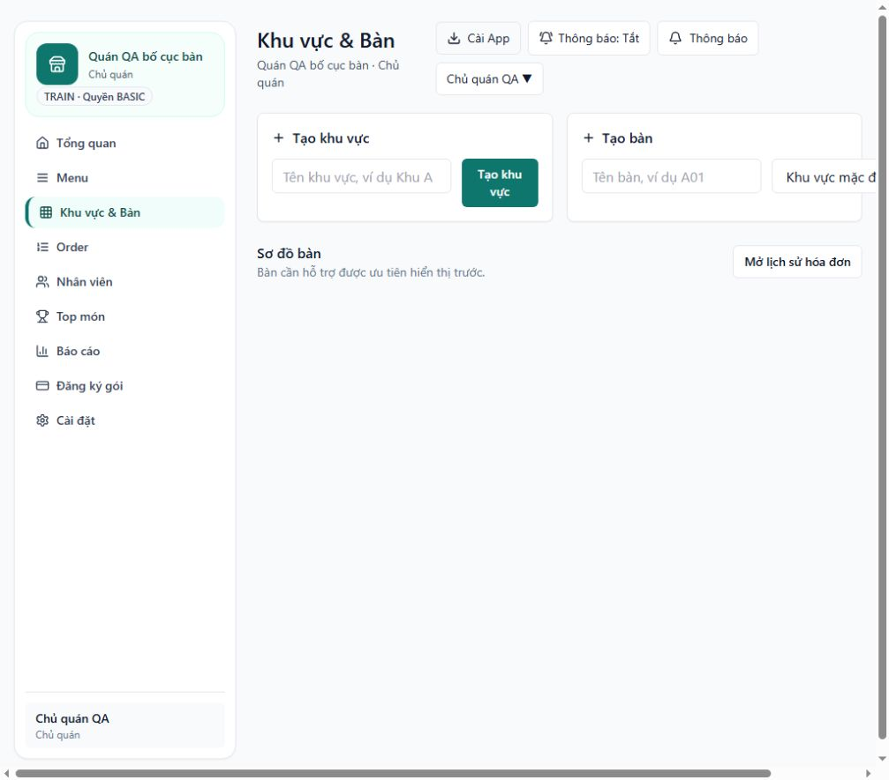
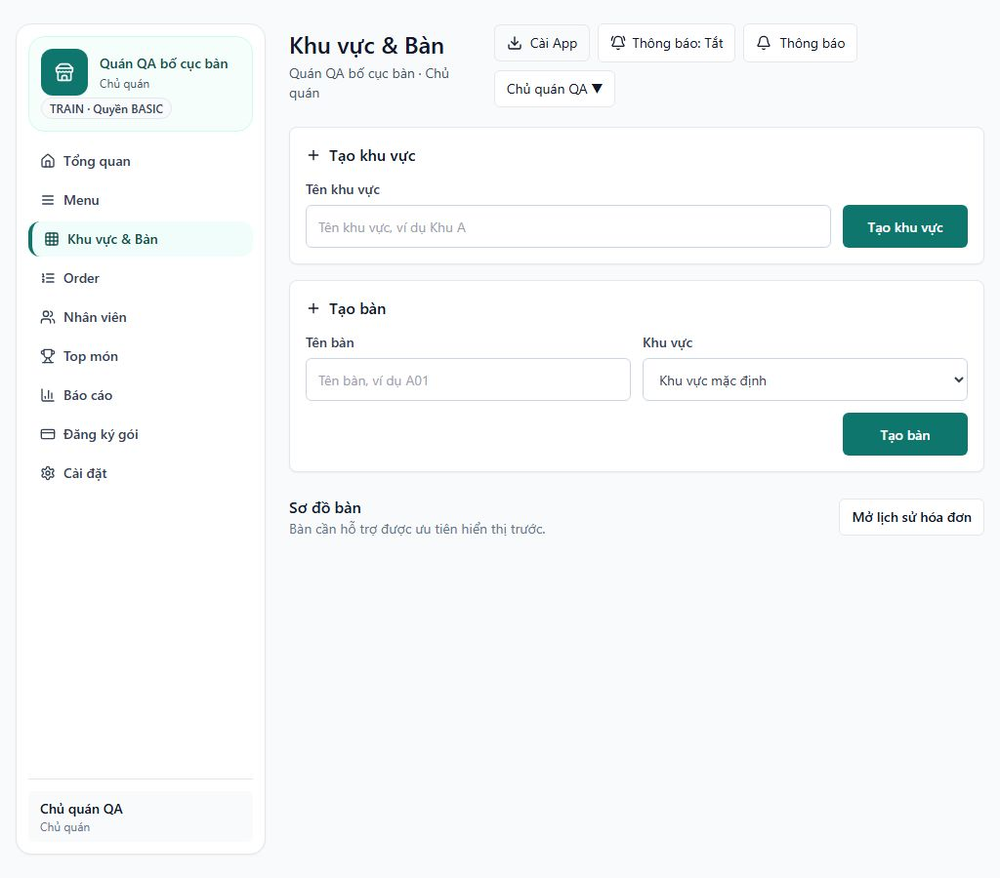
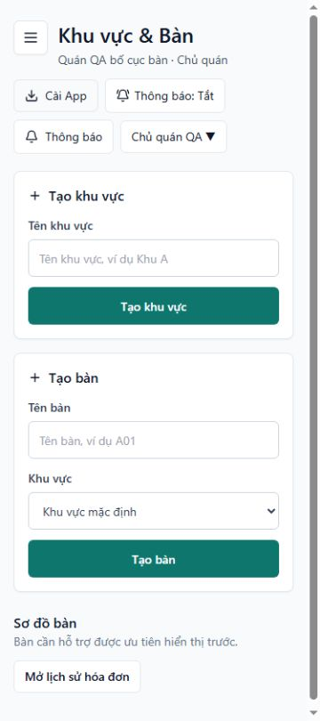

# Khu vực & Bàn — sửa bố cục và redirect

21/10/2026, attachment31440fd2. Chủ dự án cho phép kiểm thử rồi commit/push/deploy cả hai ứng dụng ngay.

## Thay đổi

- `src/app/[rSlug]/admin/tables/page.tsx`: hai form dùng label rõ ràng và CSS module riêng; giữ nguyên action bindings, name/areaId/required và danh sách khu vực.
- `creation-forms.module.css`: Grid auto-fit theo chiều rộng nội dung, min-width0, mỗi card có container query để bố trí trường/nút theo chiều rộng thực tế; nút44px, nowrap, mobile full width. Khi không đủ chỗ card xếp dọc, tránh breakpoint viewport ép hai card cạnh sidebar.
- `src/app/[rSlug]/admin/actions.ts`: ngoại lệ đã được chủ dự án duyệt riêng sau khi phát hiện QA. Chuyển redirect thành công của createTableAction ra ngoài try/catch để Next.js redirect không bị bắt thành lỗi trùng tên. Giữ validation, kiểm tenant, Prisma create, QR token, audit và revalidate; không đổi quy tắc nghiệp vụ/gói/phiên bàn.

## Kiểm thử local

- Lint, TypeScript, production build đạt. Bộ kiểm tra table-detail hiện có đạt.
- Trước sửa tại1024px: nội dung rộng1128px, nút tạo khu vực87.5px/nút bàn55.75px, cao56px do xuống dòng. Sau sửa: không tràn ở320/375/768/1024/1440px; cả hai nút44px, nowrap, các trường có chiều rộng hợp lý. [Số đo](table-layout/responsive.json).
- Browser thật dùng tài khoản ngẫu nhiên trong DB restaurant_trial_test loopback55432, quán QA riêng. Tạo khu vực, chọn khu vực, tạo bàn, sơ đồ hiển thị bàn đạt. Trước sửa redirect: DB có đúng bàn nhưng UI báo lỗi; sau sửa tạoQA-02 trả success và thông báo thành công. Gửi lại trùng tên trả error, DB vẫn đúng mộtQA-01 và mộtQA-02 ở khu vực được chọn. Không sửa quán Long Phụng hoặc dữ liệu production.
- Hồi quy password/session/tenant/multi-restaurant và22ca trial đạt. Google được kiểm bằng adapter cô lập trong regression; không gọi OAuth thật hoặc tạo QA production. Dòng QA forced failure là ca rollback chủ động.

## Phát hành

Đang chuẩn bị image CI ngoài VPS. Không migration hoặc build trên VPS1GB. Chỉ recreate app QuánPilot và web QAVIO, giữ env/flags/DB/worker/Portfolio. Giữ imagebe133f2 làm rollback QuánPilot, QAVIO3c22501. Kết quả production sẽ cập nhật sau deploy.

